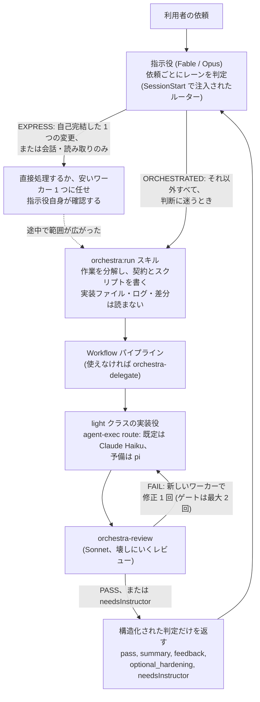

# orchestra

[English](README.md) | 日本語

**コスト階層型のマルチエージェント実行**のための Claude Code プラグインです。高価な指示役モデル(Fable/Opus など)が作業を分解してオーケストレーション用のスクリプトを書き、`agent-exec route` がタスクごとに使える最も安い実装役を選び(light と standard は Claude Haiku、予備と独立レビューは pi などの外部実行系)、Sonnet のレビュー役が結果を壊しにかかって検証し、指示役には構造化された合否の判定だけが返ります。

## なぜ必要か

すべての手順を最も高価なモデルで実行すると、そこまでの能力が要らない作業にも費用がかかります。`orchestra` は PoC で確かめた進め方を形にしたものです。実装は安いモデルに、検証は実装を積極的に壊しにいく中位モデルに任せ、高価な指示役は計画と例外対応以外では作業に関わりません。

## 仕組み



- **2 つのレーン。** `SessionStart` コマンドフックがルーターを注入し(Team/Enterprise のログインで組み込みの `cc-plugin-sec-default` が載っている環境でも動きます)、指示役は依頼ごとにレーンを判定します。EXPRESS(自己完結した 1 つの変更、または会話・読み取りのみ)は直接処理し、それ以外と判断に迷うものはすべて `orchestra:run` の手順に従います。判定は依頼をまたいで持ち越しません。
- **2 つの実行経路。** Dynamic Workflows(推奨。指示役が同梱の `orchestra:pipeline` をタスク一覧つきで実行する。`skills/run/SKILL.md` §5 を参照)と、Workflows が使えない環境での `orchestra-delegate` によるサブエージェントの入れ子です。
- **2 回のゲート。** レビューのゲート 1 回に、修正 1 回と差分だけを見る再ゲートが続きます。差し戻しには契約の該当箇所の引用が必須で、契約が求めていない改善は `optional_hardening` に回り、合否には影響しません。
- **ワーカーの隔離。** 作業ツリーに未コミットの変更があると、`agent-exec dispatch` はワーカーごとに専用の git worktree を用意します。さらにフックが、サブエージェントによる破壊的な VCS コマンドや、利用者のメインの作業ツリーへの書き込みを止めます。
- **サンドボックスと学習済み許可。** CLI ワーカーには既定で OS サンドボックスを適用します。キャッシュへの拒否は学習でき、それ以外は `needsPermission` として指示役に返り、`agent-exec sandbox allow` で許可します。
- **ウォッチドッグ。** 壁時計時間、アイドル時間、同一ツール呼び出しの反復を制限し、暴走したワーカーを止めて構造化された修正・エスカレーション信号を返します。

**どちらの経路でも守るべきルールが 1 つあります**: エージェントを呼び出すときは必ず `model` か `agentType` を明示してください。どちらも省くと、起動されたエージェントはセッションの(高価な)モデルを黙って引き継ぎ、コスト階層化が成り立たなくなります。

## インストール

このプラグインは `yacchi-plugins` マーケットプレイスで配布しています:

```text
/plugin marketplace add yacchi/claude-plugins
/plugin install orchestra@yacchi-plugins
```

`agent-exec` CLI(pi への振り分け、ワークツリー隔離、`wave run`、フックが使います)は Go で書かれており、初回の実行時にソースからビルドします。[mise](https://mise.jdx.dev/)(`tools/agentexec/.go-version` で固定した Go の版を使います)か、`PATH` 上の Go が必要です。初回の呼び出しで数秒かけてビルドし、バイナリを `~/.cache/claude-orchestra/agent-exec/` に保存します(ソースのハッシュ、OS、CPU アーキテクチャごとに分けます)。`agent-exec doctor`(`/orchestra:setup` が実行します)で事前にビルドできます。

Claude Code の中では shim は不要です。プラグインの `bin/` ディレクトリが Bash ツールの `PATH` に `agent-exec` を載せます。`agent-exec install` が引き続き必要なのは、Claude Code の外で `agent-exec` を名前で呼ぶシェル、つまり pi ワーカーのシェル(pi は子プロセスとして動き、プラグインの `bin/` を受け取るとは限りません)とご自身のターミナルです。ランナーは実行中のバイナリを絶対パスで起動し、herdr のペインは Claude Code のセッションを動かすため `bin/` を受け取るので、どちらも shim を必要としません。

ローカルで開発する場合は、マーケットプレイスのリポジトリのルートをローカルのマーケットプレイスとして追加します:

```text
/plugin marketplace add ./
/plugin install orchestra@yacchi-plugins
```

配布前にマーケットプレイスのリポジトリのルートで検証します:

```bash
claude plugin validate .
```

## 使い方

インストールすると、Opus/Fable のセッションではルーターが自動で有効になります(Sonnet/Haiku のセッションには何も注入しません)。手順を明示的に呼び出す場合:

```text
/run
```

コスト階層型の委譲が向いている作業を説明するだけでも、Claude がスキルを自動で呼び出します。手順の中で指示役は次のことを行います:

1. 作業を分解し、タスクごとの契約(文字どおりの仕様、検出すべき誤り、検証コマンド)を定める。
2. 同梱の Workflow パイプライン(`orchestra:pipeline`)にタスク一覧を渡して実行する。各タスクを light クラスの実装役 → `orchestra-review` → 最大 1 回の修正と再ゲート、と流す。設計の裁量があるタスクは `orchestra-deep`(Opus)に回す。
3. 生のログや差分、途中の成果物は受け取らず、構造化された判定だけを受け取る。

実行の統合ブランチを作業中のブランチに取り込むのは、利用者が明示的に依頼したときだけです。`agent-exec isolate land --task <into> -m "<message>"` は、利用者の identity と渡したメッセージで 1 つのコミットとして取り込みます。Claude Code の Agent が作った worktree の結果も `agent-exec isolate land --path <worktree> -m "<message>"` で同じように取り込みます。orchestra や Agent の worktree のブランチを手で merge するとフックが拒否します。

付属のスキル:

| スキル | 用途 |
|---|---|
| `/setup` (`orchestra:setup`) | pi の有無を調べ、対話形式で `orchestra.yaml` を書く |
| `/cleanup` (`orchestra:cleanup`) | リポジトリに残った orchestra の worktree とブランチを片付ける |

## 設定

設定は 4 つの層を後勝ちで深くマージします: 組み込みの既定値 ← `~/.claude/orchestra.yaml` ← `.claude/orchestra.yaml` ← `.claude/orchestra.local.yaml`。プロジェクトの設定ファイルには変えたいキーだけを書けば足ります。マージ結果は `agent-exec config` で確認できます。

- **`tiers`** — クラス/役割(`light`、`standard`、`deep`、`review`)ごとの Claude のモデル。振り分け先が `claude` になったときに使われます。加えて `planner`(既定は opus/max)は振り分けを通さず直接起動されます。
- **`external_executors`** — pi などを実装役やレビュー役として使います。既定で有効ですが、実際に使えるかどうかで選別されるため、CLI が入っていなければすべて `claude` に振り分けられます。Claude Code の中では同梱の `agent-exec` ラッパーが既に `PATH` に載っており、`agent-exec install` は Claude Code の外のシェル向けです。推奨は `Bash(agent-exec:*)` の許可ルール 1 つを加えることです。
- **`tools`** — 実行役のバイナリ(pi、herdr)を決まった版で orchestra 専用の状態ディレクトリに入れます(`agent-exec tools install`)。pi は既定で専用のエージェントディレクトリを使うため、個人の pi の設定はワーカーに届きません。
- **`sandbox.network`** — herdr ホストの外向き通信を sandbox-runtime(srt)でドメイン許可リストに絞ります。遮断した接続は記録してパッケージごとに表示し、`agent-exec sandbox allow-domain` で動いたまま許可できます(既定は `api.anthropic.com` のみ)。
- **`interactive_host`** — `wave run` で Claude 系のパッケージを動かすホストを選びます: `herdr`、`orca`、`none`(既定は `auto`)。
- **`isolation.exclude_paths`** — 依存関係やキャッシュのディレクトリを追跡しているコミットを開始点にすると、`wave run` と `dispatch` は拒否します。追跡させたままにする必要があるものは `isolation.keep_paths` で例外にします。
- **`wave.verify_mode`** — `final`(既定): 途中のテストでパッケージを止めません。パッケージごとには `fast` 指定の検査だけを記録として流し、テスト一式は最後に一度回して、失敗は緑になるまで修正パッケージとして並列に投入します。`gated` は従来どおり赤で止めます。`wave.max_in_flight: auto` では、始められるパッケージ(依存先が統合済みで、`files_owned` が動いている作業と重ならないもの)をすべて始め、依存の連鎖が長いものを優先します。機械は、重いコマンドを機械全体で数本ずつしか走らせないこと(install とビルドは `throttle.heavy_slots`、テスト・lint・型チェックは専用の `throttle.test_slots`)と、OS がメモリ不足を示している間は新しい起動を待つことで守ります。実行は `wave stop` か、指定した場合は `--budget-usd` に届くまで続き、使用量は定期的に通知します。
- **`priority`** — クラス/役割ごとの実行系の優先順。順に候補をたどる処理は `agent-exec route` / `agent-exec dispatch` が行い、指示役が手作業でたどることはありません。
- **`usage_routing`** — サブスクリプションの残量を見たルーティング。候補の背後にあるプラン(`claude` は Claude、`openai-codex/...` のモデルで動く `pi` は ChatGPT)が 5 時間枠の 80% 以上か 7 日枠の 90% 以上を使っていれば、余裕のある次の候補に回します。降格はソフト(全候補が上限近くなら無視)で、照会はキャッシュされ、失敗しても通常どおりルーティングします。`--no-usage` か `ORCHESTRA_USAGE_ROUTING=0` で無効にでき、現在値は `agent-exec doctor` の `usage_limits` で確認できます。
- **`enforcement.*`** — フックによる防護(`worker_vcs`、`worker_tree`、`worktree_lease`、`session_cleanup`、`turn_edits`、`opus_generalist`、オプトインの `light_class`、`opt_in`、`orchestra_merge`)。`opt_in` は、`/orchestra:run` で利用を開始するか確認に一度答えるまで、オーケストレーション用エージェントの起動を拒否します。`orchestra_merge` は `orchestra/*` ブランチを利用者のブランチへマージすることを拒否するため、`agent-exec isolate land` を使ってください。新しい 2 つの防護は既定で有効です。元からある防護には回避用のマーカーと環境変数による無効化スイッチがあり、`"off"` で個別に、`ORCHESTRA_ENFORCEMENT=off` で新しい 2 つを無効化できます。

コメント付きの全項目は [`examples/orchestra.yaml`](examples/orchestra.yaml) を、マージの手順と各オプションは [`skills/run/references/config.md`](skills/run/references/config.md) を参照してください。`/setup` を使えばファイルを代わりに編集してくれます。

### HUD

orchestra のエージェント（`orchestra:*` サブエージェントと Workflow のエージェント）が動いている間、Claude Code のステータス行に `orch ▸ 3 running · haiku 2 · sonnet 1 · ext 1` を表示します（`ext` は外部の pi 実行、`✗N` はレビュー失敗数）。完了すると自動で消えます。ウェーブがあると、ウェーブの表示 `wave 12/40 · 5 running · 2 needs · ~35m`（統合済み/全パッケージ数、実行中のパッケージ数、未解決の needs 数、パッケージに見積もりがあるときの残り時間の見込み）が加わり、run が停止するかランナーが終了するまで `wave status --json` の `progress` から 15 秒ごとに更新されます。複数のウェーブは並べて表示します。ウェーブは、それを起動する `agent-exec wave run --state <path>` から追跡します。起動するのはメインスレッド（通常は `run_in_background`）か、監視役のサブエージェント `orchestra:orchestra-wave`（`wave run --detach` のあと `wave wait --state <path>`）で、それ以外のサブエージェントの呼び出しは無視します。`orchestra` ペインには追跡中の各ウェーブの詳細を表示します。run id、統合済み/全数、経過時間、残り時間、コストに続けて、実行中のパッケージ（`id  cls→model  phase  経過/見積もり`、フェーズは 実装/検証/修正/統合/待機）、needs、次に始まるもの、直近に統合したものです。ペインは頼んだときだけ開きます。`/orchestra:progress` で開閉でき、ペイン内の「閉じる」ボタン（ホットキー `x`）でどの画面からでも閉じられます。モバイルアプリは今のところ mod の画面を描かないので、モバイルではウェーブのダッシュボードを開いてください。claude.ai の Artifact のページ（`dashboard.artifact_url`。セッション最初のウェーブの前に `run` スキルが、または `/setup` が公開して URL を記録します）で、監視役の `orchestra-wave` がホップごとに進捗、未決の承認、マシンの負荷を書き込みます。ページ上でその承認を許可・拒否でき、監視役がそれを適用します。ランナーが終了したときに途中だったパッケージは「中断」として出ます（`progress.interrupted`、行には `· N interrupted`）。不要になった run や計画は、ページの「削除」ボタン（5 秒以内に 2 回押す）で 1 件ずつ、または終わった run をまとめて消せます。ページを開ける人は Artifact 自体の共有設定に従います（既定は本人のみ）。監視役の進捗の行とプッシュ通知も、これまでどおりホップごと、need ごとに状況を伝えます。ペインがないときは、プロンプトの上（ターミナルとデスクトップ）に最大 4 行の帯を表示します。run id 付きのステータス行、実行中の先頭のパッケージ、needs、次に始まるものです。トースト表示は注目すべき失敗（レビュー FAIL、`needs-permission`、`runaway`、`unavailable`、`ESCALATE`、エージェントエラー）のときと、ウェーブの新しい need ごとに 1 回だけです。ウェーブ全体の様子は、どの端末でも上記のダッシュボードのページで見られます。その前の planner の計画（いまの段、子のエージェント、未解決の質問）も同じページに出ます。`hud` プラグインオプション（既定はオン）で無効にできます。

### Copilot CLI / opencode からの移行

v0.43.0で、同じモデルへより速く軽く到達できるpiを採用し、Copilot CLIとopencodeの実行役を削除しました。
Copilotのモデルはpiの`github-copilot/*`、ChatGPTサブスクリプションのモデルは`openai-codex/*`を使います。単体の Codex CLI エグゼキュータは 0.52.0 で削除され、同じモデルは pi で動かします。
どちらのプロバイダも`agent-exec pi login --provider <id>`でログインし(Claudeが実行してURLとコードを表示するので、ユーザーはそれを開くだけ)、古いキーを削除するため`orchestra:setup`を再実行してください。

## 構成

| パス | 役割 |
|---|---|
| `agents/orchestra-light.md` | 機械的な実装を担うワーカー(Haiku) |
| `agents/orchestra-deep.md` | 設計判断を伴う実装を担うワーカー(Opus) |
| `agents/orchestra-review.md` | 使い捨ての probe で壊しにいくレビュー役。契約を引用した厳格な判定を返す(Sonnet) |
| `agents/orchestra-delegate.md` | Workflows が使えない環境での中間管理役(Sonnet) |
| `skills/run/` | 手順書本体と、必要なときに読む参考資料(`authoring`、`gates`、`isolation`、`config`、`programme`、`external-executors`、`poc-findings`) |
| `skills/setup/`、`skills/cleanup/` | 付属のスキル |
| `tools/agent-exec` | `agent-exec` CLI の起動スクリプト。初回に `tools/agentexec/` をビルドし、保存したバイナリを実行します |
| `tools/agentexec/` | `agent-exec` CLI(Go): route、dispatch、isolate、shelf、wave、telemetry、版を固定して管理する実行役バイナリ(pi と herdr)、herdr と Orca の対話ホストなど |
| `hooks/` | ルーターの注入、ターン規模の検知、ワーカーの VCS・作業ツリー・lease の防護、Opus 汎用サブエージェントへの通知、worktree の後片付け |
| `examples/orchestra.yaml` | 設定のサンプル |

ファイルごとの詳細: [`docs/components.md`](docs/components.md)

## 関連資料

`docs/` 配下は英語、`feedback/` は日本語です。

- [`docs/design-notes.md`](docs/design-notes.md) — ゲート、worktree による隔離、stash の代替、worktree の lease がなぜあるのか、それぞれのきっかけになった事象
- [`docs/components.md`](docs/components.md) — エージェント、スキル、ツール、フックそれぞれの詳しい役割
- [`docs/poc.md`](docs/poc.md) — PoC の測定結果と外部実行系のモデル比較
- [`feedback/`](feedback/) — 日付ごとの利用状況の振り返り
