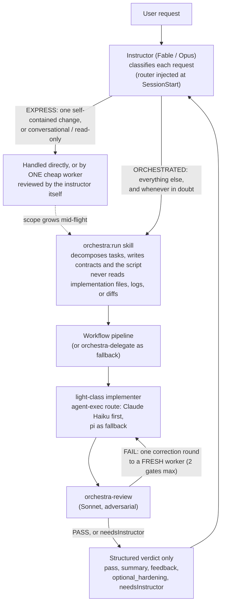

# orchestra

English | [日本語](README.ja.md)

A Claude Code plugin for **cost-tiered multi-agent orchestration**: an expensive instructor model (e.g. Fable/Opus) decomposes work and writes orchestration scripts, `agent-exec route` picks the cheapest ready implementer for each task (Claude Haiku for light and standard work, with pi as the fallback and for independent-review work), Sonnet reviewers adversarially check the result, and only structured pass/fail verdicts flow back up.

## Why

Running every step of a task on your most expensive model wastes money on work that doesn't need it. `orchestra` codifies a pattern validated by a proof of concept: route implementation to a cheap model, route verification to a mid-tier model that actively tries to break the implementation, and keep the expensive instructor model out of the loop entirely except for planning and exception handling.

## How it works



- **Two lanes.** A `SessionStart` hook injects a router that makes the instructor classify every request. EXPRESS (one self-contained change, or conversational/read-only) is handled directly; everything else — and anything in doubt — goes through the `orchestra:run` playbook. Lane choices never persist across requests.
- **Two execution paths.** Dynamic Workflows (preferred: the instructor runs the shipped `orchestra:pipeline` workflow with a task list, see `skills/run/SKILL.md` §5), or nested subagents via `orchestra-delegate` when Workflows are unavailable.
- **Two gates.** One review gate plus at most one correction round and an incremental re-gate. A rejection must cite the contract; non-required improvements go to `optional_hardening` and never block.
- **Isolated workers.** When the working tree holds uncommitted work, `agent-exec dispatch` gives each worker its own git worktree, and hooks keep subagents from running destructive VCS commands or writing into your main tree.
- **Sandbox and learned grants.** CLI workers use the OS sandbox by default; cache denials may be learned, while other denials return `needsPermission` for instructor approval via `agent-exec sandbox allow`.
- **Watchdog.** Wall, idle, and repeated-tool-call limits stop runaway workers and return a structured correction/escalation signal.

**The one rule that matters in both paths**: every agent invocation must explicitly set `model` or `agentType`. Omitting both causes the spawned agent to silently inherit the session's (expensive) model, which defeats the entire cost-tiering strategy.

## Installation

This plugin is distributed as part of the `yacchi-plugins` marketplace:

```text
/plugin marketplace add yacchi/claude-plugins
/plugin install orchestra@yacchi-plugins
```

The `agent-exec` CLI (used by pi dispatch, worktree isolation, `wave run`, and the hooks) is written in Go and built from source on first use: it needs [mise](https://mise.jdx.dev/) (agent-exec then uses the Go version pinned in `tools/agentexec/.go-version`) or Go on `PATH`. The first call builds it in a few seconds and caches the binary under `~/.cache/claude-orchestra/agent-exec/`, keyed by the source hash, OS and CPU arch; `agent-exec doctor` (run by `/orchestra:setup`) builds it ahead of time.

Inside Claude Code no shim is needed: the plugin's `bin/` directory puts `agent-exec` on the Bash tool's `PATH`. `agent-exec install` is still needed for a shell outside Claude Code that must run `agent-exec` by name: a pi worker's shell (pi is a child process and does not necessarily get the plugin's `bin/`) and your own terminal. The runner starts the binary it is running from by absolute path, and herdr panes host Claude Code sessions, which get `bin/`; neither needs the shim.

For local development, add the marketplace repository root as a local marketplace instead:

```text
/plugin marketplace add ./
/plugin install orchestra@yacchi-plugins
```

Validate from the marketplace repository root before distributing:

```bash
claude plugin validate .
```

## Usage

Once installed, the router activates on its own in Opus/Fable sessions (Sonnet/Haiku sessions get nothing injected). To invoke the playbook explicitly:

```text
/run
```

Or just describe a task that needs cost-tiered delegation — Claude can invoke the skill automatically. The playbook has the instructor:

1. Decompose the task and define per-task contracts (literal spec, the mistakes to detect, a verification command).
2. Run the shipped Workflow pipeline (`orchestra:pipeline`) with a task list, which pipelines each task through a light-class implementer → `orchestra-review` → at most one correction round and re-gate. Design-latitude tasks go to `orchestra-deep` (Opus) instead.
3. Receive only structured verdicts, never raw logs, diffs, or intermediate files.

Companion skills:

| Skill | Purpose |
|---|---|
| `/setup` (`orchestra:setup`) | Detect pi and write `orchestra.yaml` interactively |
| `/cleanup` (`orchestra:cleanup`) | Reclaim leftover orchestra worktrees and branches in the repository |

## Configuration

Config is deep-merged from four layers (later wins): built-in defaults ← `~/.claude/orchestra.yaml` ← `.claude/orchestra.yaml` ← `.claude/orchestra.local.yaml`. A project file only needs the keys it changes. `agent-exec config` prints the merged result.

- **`tiers`** — Claude models per class/role (`light`, `standard`, `deep`, `review`), used whenever routing resolves to `claude`, plus `planner` (default opus/max), which is spawned directly and never routed.
- **`external_executors`** — pi, … as implementers or reviewers. Enabled by default but gated on real availability; with the CLI not installed, everything resolves to `claude`. Inside Claude Code the bundled `agent-exec` wrapper is already on `PATH`; `agent-exec install` is for shells outside it. The recommended setup adds one `Bash(agent-exec:*)` allow rule.
- **`tools`** — pins executor binaries (pi, herdr) to a known version in orchestra's own state dir (`agent-exec tools install`). pi runs with its own agent dir by default, so your personal pi settings do not reach workers.
- **`sandbox.network`** — the herdr host's outbound domain allowlist, enforced by sandbox-runtime (srt); blocked hosts are audited and surfaced per package, `agent-exec sandbox allow-domain` approves one live (default `api.anthropic.com` only).
- **`interactive_host`** — which host runs Claude-tier packages in `wave run`: `herdr`, `orca`, or `none` (default `auto`).
- **`wave.verify_mode`** — `final` (default): packages are not held back by tests; only checks marked `fast` run per package (recorded, never blocking), and the full checks run once at the end, where failures become fix-up packages until green. `gated` keeps the old stop-on-red behavior. `wave.max_in_flight: auto` starts every package that can start (dependencies integrated, no overlapping `files_owned`), longest dependent chain first; the machine is protected instead by admitting heavy local commands a few at a time machine-wide — installs and builds on `throttle.heavy_slots`, tests, lints and typechecks on their own `throttle.test_slots` pool and by holding new starts while the OS reports memory pressure. A run keeps going until `wave stop` or an optional `--budget-usd`, with periodic usage notices.
- **`priority`** — ordered executors per class/role. `agent-exec route` / `agent-exec dispatch` perform the walk so the instructor never does it by hand.
- **`usage_routing`** — subscription-aware routing: a candidate whose plan (Claude for `claude`, ChatGPT for `pi` on `openai-codex/...`) has used at least 80% of its 5-hour or 90% of its 7-day window is demoted to the next candidate with room. The demotion is soft (when every candidate is over, the walk ignores it), the lookup is cached and fail-open, and `--no-usage` / `ORCHESTRA_USAGE_ROUTING=0` turn it off. `agent-exec doctor` shows the numbers under `usage_limits`.
- **`enforcement.*`** — the hook guards (`worker_vcs`, `worker_tree`, `worktree_lease`, `session_cleanup`, `turn_edits`, `opus_generalist`, opt-in `light_class`). Each has an escape marker and an environment kill switch.

See [`examples/orchestra.yaml`](examples/orchestra.yaml) for the full commented schema and [`skills/run/references/config.md`](skills/run/references/config.md) for the merge algorithm and every option. `/setup` edits the file for you.

### HUD

While orchestra agents run (`orchestra:*` subagents and Workflow agents), the Claude Code status line shows `orch ▸ 3 running · haiku 2 · sonnet 1 · ext 1` (`ext` = external pi dispatches, `✗N` = failed reviews), and clears itself when they finish. A wave adds a wave part, `wave 12/40 · 5 running · 2 needs · ~35m` (integrated/total packages, packages in flight, open needs, the estimated time left when packages carry estimates), refreshed every 15 s from the `progress` of `wave status --json` until the run stops or its runner exits; several waves show side by side. A wave is tracked from the `agent-exec wave run --state <path>` that starts it, run by the main thread (usually with `run_in_background`) or by the `orchestra:orchestra-wave` watcher subagent (`wave run --detach`, then `wave wait --state <path>`); other subagents' calls are ignored. The `orchestra` pane shows each tracked wave in detail: run id, integrated/total, elapsed, time left and cost, then the running packages (`id  cls→model  phase  elapsed/est`, phases 実装/検証/修正/統合/待機), the needs, what starts next and what was integrated last. It opens only when asked: `/orchestra:progress` toggles it, and its own 閉じる button (hotkey `x`) closes it on any surface. The mobile app draws no mod UI today; there, open the wave dashboard: a claude.ai Artifact page (`dashboard.artifact_url`, published and recorded by the `run` skill before the first wave of a session, or by `/setup`) that the `orchestra-wave` watcher updates after every hop with the progress, the pending approvals and the machine load, and where you can approve or deny those approvals; the watcher applies them. Who may open it follows the Artifact's own sharing (private by default). The watcher's progress lines and the push notifications still report every hop and every need. Without the pane, a band of up to four lines above the prompt (terminal and desktop) shows the status line with the run id, the first running packages, the needs and what starts next. A toast appears only on notable failures (review FAIL, `needs-permission`, `runaway`, `unavailable`, `ESCALATE`, agent error) and once for each new wave need. The wave dashboard page above is the full view of a wave on any device. Turn the HUD off with the `hud` plugin option (default on).

### Migrating from Copilot CLI / opencode

In v0.43.0, the Copilot CLI and opencode executors were removed because pi is a faster, lighter path to the same models.
Use pi's `github-copilot/*` provider for Copilot models and `openai-codex/*` for ChatGPT-subscription models. The standalone Codex CLI executor was removed in 0.52.0; pi drives the same models.
Log in to either provider with `agent-exec pi login --provider <id>` (Claude runs it and shows you the URL/code to open), then re-run `orchestra:setup` to remove old configuration keys.

## Components

| Path | Role |
|---|---|
| `agents/orchestra-light.md` | Mechanical implementation worker (Haiku) |
| `agents/orchestra-deep.md` | Design-sensitive implementation worker (Opus) |
| `agents/orchestra-review.md` | Adversarial reviewer with throwaway probes; strict, contract-cited verdict (Sonnet) |
| `agents/orchestra-delegate.md` | Middle manager for environments without Workflows (Sonnet) |
| `skills/run/` | The playbook, plus on-demand references (`authoring`, `gates`, `isolation`, `config`, `programme`, `external-executors`, `poc-findings`) |
| `skills/setup/`, `skills/cleanup/` | Companion skills |
| `tools/agent-exec` | Bootstrap for the `agent-exec` CLI: builds `tools/agentexec/` on first use and runs the cached binary |
| `tools/agentexec/` | The `agent-exec` CLI (Go): route, dispatch, isolate, shelf, wave, telemetry, managed executor binaries (pinned pi and herdr), the herdr/Orca interactive hosts, … |
| `hooks/` | Router injection, turn-size tripwire, worker VCS/tree/lease guards, Opus-generalist nudge, worktree cleanup |
| `examples/orchestra.yaml` | Sample configuration |

Per-file detail: [`docs/components.md`](docs/components.md).

## Further reading

- [`docs/design-notes.md`](docs/design-notes.md) — why the gates, worktree isolation, stash replacement, and worktree leases exist, and the incidents that led to each
- [`docs/components.md`](docs/components.md) — detailed role of every agent, skill, tool, and hook
- [`docs/poc.md`](docs/poc.md) — PoC measurements and the external-executor model comparison
- [`feedback/`](feedback/) — dated usage reviews
